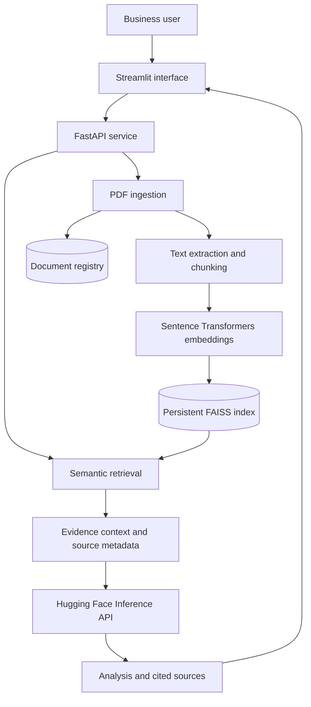

# Enterprise Knowledge Intelligence Platform

An evidence-grounded document intelligence prototype for analysing an organisation's internal PDF knowledge. The application supports document ingestion, semantic retrieval, question answering, summaries, comparisons, risk/gap analysis, conflict exploration, and recommendations with source traceability.

> This is an assessment-ready prototype, not a production-secure multi-tenant enterprise deployment.

## Product goal

Move beyond a basic PDF chatbot. The platform turns business documents into a searchable knowledge base and helps users investigate information across documents. Answers include the retrieved source file, page, chunk, and retrieval distance so that users can inspect the evidence.

## Architecture



## Features

- Upload and index multiple PDF documents.
- Persistent local FAISS vector index.
- Document inventory with chunk counts and indexing timestamps.
- Knowledge-base reset endpoint with an explicit confirmation in the UI.
- Evidence-grounded research, executive summaries, comparisons, risk/gap analysis, conflict exploration, and recommendations.
- Source metadata with original filename, page number, chunk identifier, and retrieval distance.
- Empty-retrieval fallback that declines to answer when no passages are retrieved.
- FastAPI health endpoint and structured error handling.

## Technology

- Python
- Streamlit
- FastAPI
- LangChain
- Hugging Face Inference API
- Sentence Transformers: `sentence-transformers/all-MiniLM-L6-v2`
- FAISS CPU

## Project layout

```text
.
├── main.py                 # FastAPI endpoints
├── streamlit_app.py        # Streamlit UI
├── knowledge_base.py       # Ingestion and document registry
├── vector_store.py         # FAISS persistence
├── chunk_utils.py          # PDF loading and chunking
├── rag_pipeline.py         # Retrieval, prompting, source metadata
├── hf_llm.py               # Hugging Face model adapter
├── config.py               # Environment configuration
├── data/
│   ├── uploads/            # Uploaded PDFs (created at runtime)
│   ├── vectorstore/        # FAISS index (created at runtime)
│   └── knowledge_base/     # Document registry (created at runtime)
└── tests/
    └── test_rag_pipeline.py
```

## Setup

Use Python 3.10 or 3.11 in a virtual environment. Install the pinned project dependencies:

```bash
python -m venv .venv
# Windows PowerShell
.venv\Scripts\Activate.ps1
pip install -r requirements.txt
```

Create a `.env` file using `.env.example`:

```env
HF_TOKEN=your_huggingface_token
HF_MODEL=Qwen/Qwen3-4B-Instruct-2507
HF_PROVIDER=nscale
CHUNK_SIZE=800
CHUNK_OVERLAP=100
TOP_K=5
```

The Hugging Face model and provider must be enabled for the account and available through the Inference API. Do not commit the real token.

## Run locally

Terminal 1 — backend:

```bash
python -m uvicorn main:app --reload
```

Terminal 2 — frontend:

```bash
streamlit run streamlit_app.py
```

Open the Streamlit URL shown in the terminal. FastAPI documentation is available at `http://localhost:8000/docs`; health check: `GET /health/`.

## API

| Method | Endpoint | Purpose |
|---|---|---|
| GET | `/health/` | Service health |
| POST | `/documents/` | Upload and index one PDF |
| GET | `/documents/` | List registered documents |
| DELETE | `/knowledge-base/` | Clear the local knowledge base |
| POST | `/research/` | Retrieve evidence and generate an analysis |

Research request:

```json
{
  "question": "Compare the operational risks described in the uploaded reports."
}
```

Research response shape:

```json
{
  "question": "...",
  "answer": "...",
  "sources": [
    {
      "file": "Operations Report.pdf",
      "page": 4,
      "chunk_id": 2,
      "retrieval_distance": 0.42
    }
  ]
}
```

## Validation

Run the focused retrieval tests:

```bash
pytest -q
```

Recommended manual evaluation before a live demonstration:

1. Clear the knowledge base and confirm that research is refused because no documents are indexed.
2. Index one document and ask a question whose answer is explicitly stated in it.
3. Confirm that the cited filename and page are correct.
4. Ask a question unrelated to the indexed document. Verify that the answer does not invent unsupported facts.
5. Index a second document and ask a cross-document comparison question.
6. Test a conflict question with two documents that genuinely disagree, and another where dates or scope differ.
7. Restart the backend and confirm that the index and document inventory persist.

## Important limitations and next steps

- Retrieval distance is exposed for evaluation; a rejection threshold has deliberately not been hard-coded before measuring relevant and irrelevant query scores with the configured embedding model and FAISS metric.
- The current reset operation clears the entire local knowledge base. Per-document deletion and re-indexing are not implemented.
- PDF is the only supported input format in this prototype.
- The registry and FAISS index are local files. This version does not implement authentication, tenant isolation, encryption-at-rest, role-based access, audit trails, or cloud deployment.
- Scanned PDFs may require OCR before ingestion.
- Generated analysis must be reviewed against its cited passages before it is used for business decisions.

## Security notes

- Keep `.env`, uploaded business documents, and generated vector-store files out of source control.
- FAISS persistence uses LangChain's local pickle-backed metadata. Only load index files created by this trusted application; do not load an index supplied by an untrusted party.
- Do not expose the local API publicly without authentication, authorization, upload limits, and secure storage.
